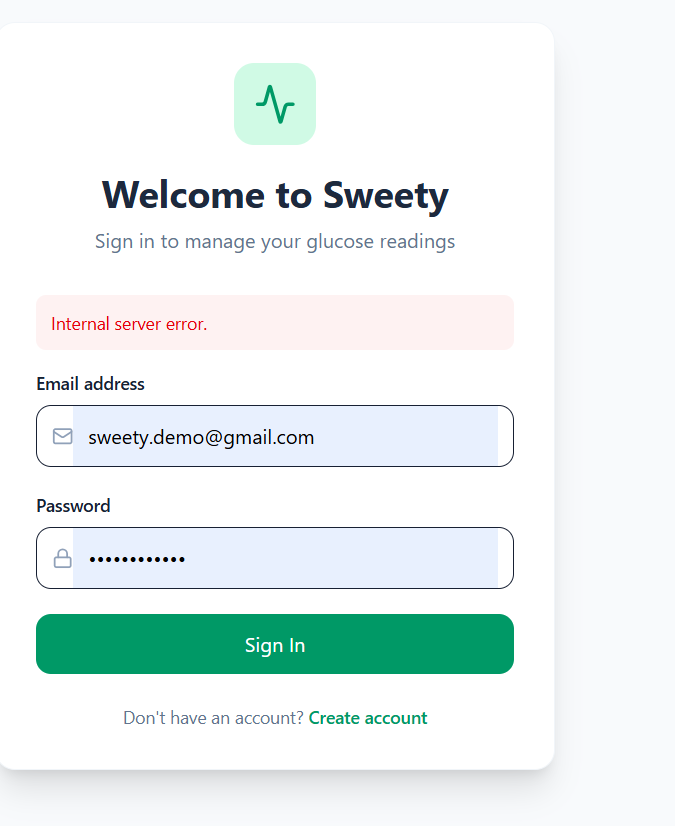
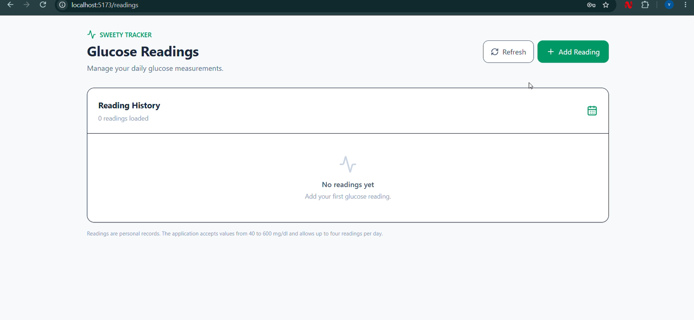
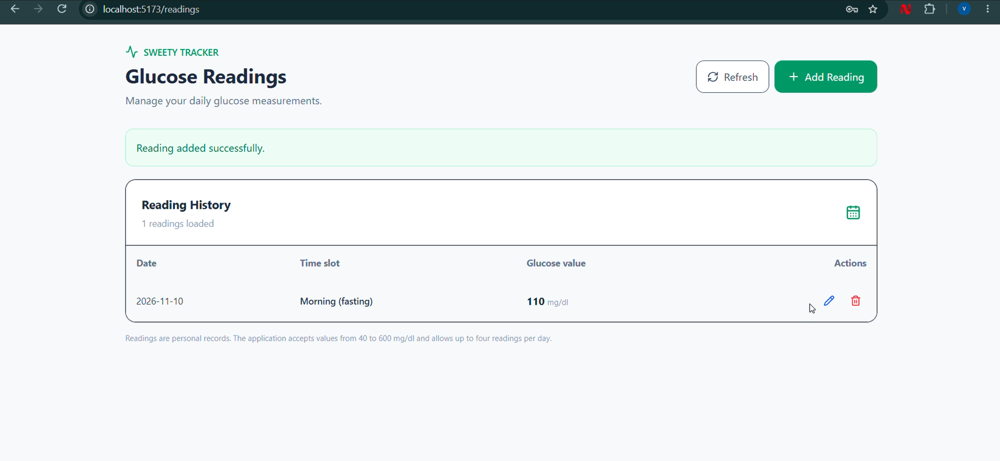
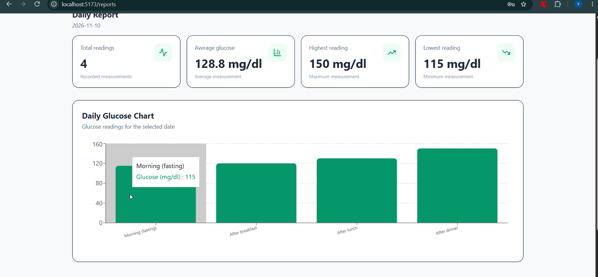

# Sweety – Blood Glucose Tracker

Sweety is a full-stack web application that helps users record, manage, and review their daily blood glucose measurements.

## Features

- User registration and login
- JWT-based authentication
- Secure password hashing
- Personal glucose reading management
- Add, view, edit, and delete readings
- Four daily time slots:
  - Morning (fasting)
  - After breakfast
  - After lunch
  - After dinner
- Daily reading limit and duplicate-slot validation
- Dashboard with average, highest, and lowest readings
- Daily, month-to-date, and previous-month reports
- Interactive glucose charts
- Automated backend API tests
- User-specific data access

## Technology Stack

### Frontend
- React
- Vite
- Tailwind CSS
- React Router
- Axios
- Recharts
- Lucide React

### Backend
- Node.js
- Express.js
- PostgreSQL
- Prisma ORM
- JSON Web Tokens
- bcrypt
- Zod

### Testing
- Jest
- Supertest

## Project Structure

```text
sweety/
+-- client/
¦   +-- src/
¦   ¦   +-- pages/
¦   ¦   +-- services/
¦   ¦   +-- components/
¦   ¦   +-- App.jsx
¦   ¦   +-- main.jsx
¦   +-- .env.example
¦
+-- server/
¦   +-- prisma/
¦   ¦   +-- migrations/
¦   ¦   +-- schema.prisma
¦   +-- src/
¦   ¦   +-- config/
¦   ¦   +-- controllers/
¦   ¦   +-- middleware/
¦   ¦   +-- routes/
¦   ¦   +-- validators/
¦   +-- tests/
¦   +-- .env.example
¦
+-- .gitignore
```

## Requirements

- Node.js
- npm
- PostgreSQL

## Installation

### 1. Clone the repository

```bash
git clone YOUR_GITHUB_REPOSITORY_URL
cd sweety
```

### 2. Configure the backend

```bash
cd server
npm install
```

Copy `.env.example` to `.env` and configure your PostgreSQL connection and JWT secret.

### 3. Configure the database

Create a PostgreSQL database named `sweety_db`.

Run:

```bash
npx prisma generate
npx prisma migrate deploy
```

### 4. Start the backend

```bash
npm run dev
```

The backend runs at:

`http://localhost:5000`

### 5. Configure the frontend

Open another terminal:

```bash
cd client
npm install
```

Copy `.env.example` to `.env` and configure `VITE_API_URL`.

### 6. Start the frontend

```bash
npm run dev
```

The frontend runs at:

`http://localhost:5173`

## API Endpoints

### Authentication

| Method | Endpoint | Description |
|---|---|---|
| POST | /api/auth/register | Register a user |
| POST | /api/auth/login | Log in |
| GET | /api/auth/me | Get current user |

### Glucose Readings

All reading endpoints require JWT authentication.

| Method | Endpoint | Description |
|---|---|---|
| POST | /api/readings | Create reading |
| GET | /api/readings | List readings |
| GET | /api/readings/:id | Get one reading |
| PUT | /api/readings/:id | Update reading |
| DELETE | /api/readings/:id | Delete reading |

### Reports

| Method | Endpoint | Description |
|---|---|---|
| GET | /api/readings/reports/daily | Daily report |
| GET | /api/readings/reports/month-to-date | Current month report |
| GET | /api/readings/reports/previous-month | Previous month report |

## Validation Rules

- Glucose values must be integers between 40 and 600 mg/dl.
- A user can record up to four readings per day.
- Each time slot can have only one reading per day.
- Future reading dates are not allowed.
- Users can access only their own readings.

## Running Tests

From the server directory:

```bash
npm test
```

The automated tests use a separate test database. Configure `.env.test` before running them.

## Security

- Passwords are hashed before storage.
- Protected API routes require JWT authentication.
- User records are scoped to the authenticated account.
- Environment files containing secrets must never be committed.

## Disclaimer

Sweety is a personal glucose-recording and reporting application. It is not a medical diagnostic system and does not replace professional healthcare advice.

## Author

Developed as a full-stack web application project.

## Demo Account

After configuring the database and running migrations, execute:

```bash
cd server
npm run db:seed
```

The seed script creates or updates a local demo account and inserts four sample readings for the current date.

**Local demo credentials:**

- Email: `demo@sweety.local`
- Password: `SweetyDemo@2026`

These credentials are intended only for local evaluation. Change them before using any publicly accessible deployment.

## Database Seeding

The seed script is located at:

`server/prisma/seed.js`

It uses an upsert operation, so running it again updates the demo account and its four sample readings instead of creating duplicate records.

## Notes

### Assumptions

- Each user can record up to four glucose readings per day.
- Each daily time slot can contain only one reading.
- Glucose readings are stored as integer values in mg/dl.
- Users can access only their own readings.
- The application uses four predefined daily time slots.
- Reports summarize recorded measurements and do not provide medical diagnoses.

### Future Improvements

- Add password reset and email verification.
- Improve session management and token storage.
- Add CSV and PDF report exports.
- Add configurable glucose reference ranges.
- Add more advanced historical charts and trends.
- Improve automated frontend testing.
- Deploy the frontend, backend and database to cloud hosting.
- Add stronger monitoring, logging and production security controls.

## Screenshots and Demo

Application screenshots and a short 2–3 minute demonstration video will be added to the repository.


## Application Screenshots

### Login


### Dashboard


### Blood Glucose Readings


### Reports and Analytics


